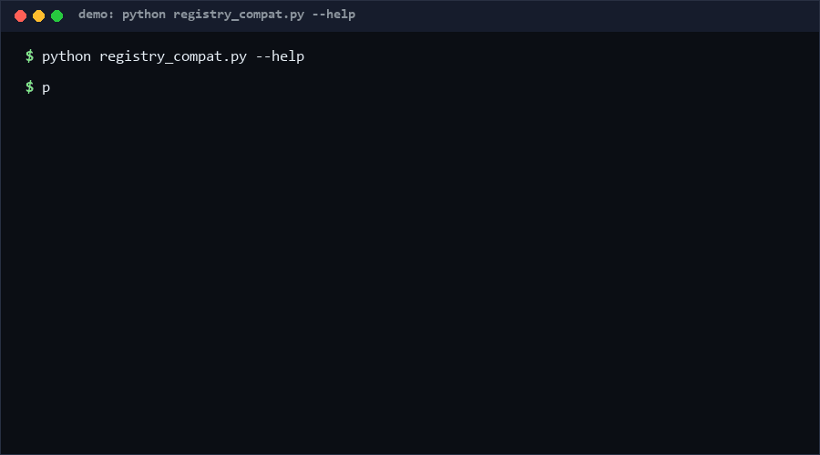

# mcp-registry-migration

When an ecosystem moves its catalog from a hand-edited manifest to a queryable registry, downstream tooling breaks. This repo is a governance sample for that migration: a query-interface spec plus a compatibility layer that maps legacy manifests and reports what changed — nothing dropped silently.

Migration pattern version: **0.1** · Data currency: **as of 2026-10-11**.

<p align="center"></p>

## Problem

The MCP ecosystem made this move publicly: the reference-servers repository reduced itself to a handful of teaching implementations and handed catalog duties to a real registry (`registry.modelcontextprotocol.io`) — a signal, as of 2026-10-11, that README-curated lists had hit their governance ceiling. Every ecosystem that does this (MCP, awesome-lists going database, package indexes) hits the same failure window: old consumers keep scraping the stale manifest, contributors don't know where to submit, and archived entries vanish from view without a trace. The migration itself is under-engineered; the *transition* is the hard part, not the endpoint.

## How it works

**Registry record schema (spec v0.1):**

```json
{"name": "server-x", "version": "1.0", "transport": "stdio",
 "status": "active|archived|deprecated", "package": {"name": "npm:pkg"},
 "description": "..."}
```

**Canonical query interface:** filter by case-insensitive name substring, exact `transport` (`stdio` / `streamable-http` / `sse`), exact `status`. Results are sorted and deterministic — a query must return the same answer twice, which is precisely what a hand-edited manifest cannot promise.

**Compatibility layer:**

- `validate` — registry sanity: schema, plus duplicate-name detection.
- `manifest-map` — converts legacy manifest entries into registry-shaped records (status `active`, transport `stdio` assumed with a warning, every unmapped field reported, never dropped silently).
- `diff` — three-way comparison: `only_in_manifest` (about to be lost), `only_in_registry` (new), `status_changed` (archived/deprecated entries) — the governance report a maintainer publishes at migration time.

## Quickstart (~3 min)

```bash
# Step 1: validate a registry file (~1 s)
python registry_compat.py validate --registry registry.json

# Step 2: query it (~1 s)
python registry_compat.py query --registry registry.json --name git --status active

# Step 3: map a legacy manifest (~1 s; warnings show what was dropped)
python registry_compat.py manifest-map --manifest legacy.json > mapped.json

# Step 4: the migration report (~1 s)
python registry_compat.py diff --manifest legacy.json --registry registry.json

# Full self test (~20 s)
python self_test.py
```

## Why not X

| Alternative | Why not |
|---|---|
| Keep the README manifest forever | Non-queryable, merge-conflict-prone, no statuses; the ecosystem already outgrew it (hence the migration). |
| Jump straight to the registry, skip compatibility | Every downstream scraper breaks the day the manifest freezes; unmapped entry metadata is lost with no audit trail. |
| Full registry server implementation | This repo is the *governance sample*: schema, query contract, transition reporting. Running infrastructure is a different project with different trust requirements. |
| One-off migration scripts in a gist | Unreviewed, untested, and forgotten; the transition deserves the same test discipline as the endpoint. |

## Minimal Fallback

No Python? The schema and query contract above are copy-pasteable into any jq/sqlite workflow: `jq '.servers[] | select(.status=="active")' registry.json` reproduces the most common query; the diff is two sorted name lists you can `comm` together.

## Design Trade-offs

Priority: **nothing-lost-silently > deterministic queries > simplicity > throughput**. Warnings are preferred over errors for unmapped manifest fields (a migration must surface loss, not stop on it); diffs are name-keyed only (no fuzzy matching) because false "same server" claims during migration are worse than manual review. Transport defaults to `stdio` with an explicit warning rather than guessing — an assumed default is documented, a silent guess is a future incident.

## Limits & Second-order Effects

- v0.1 has no authentication, pagination, or live-network sync — it operates on files you provide.
- Name-keyed diffing misses renamed servers (rename reads as delete+add); run `diff` with human eyes, not as the sole gate.
- **Second-order effects**: a successful migration can *hide* deprecation — entries move from a README everyone reads to a registry nobody queries, so "archived" becomes effectively invisible. Publishing the `diff` report is not optional hygiene; it is the entire governance point. Also, once querying is easy, consumers may over-trust registry `status` fields that nobody maintains after launch — a registry can rot faster than a README because its staleness is less visible.

## FAQ

**When NOT to use this sample?** If your catalog has fewer than ~20 entries and one maintainer, a manifest is cheaper and fine. If you need a production registry with auth and uptime, this gives you a spec, not a server. If your ecosystem has no deprecation concept, `diff` has nothing to report.

**Is this affiliated with the official MCP registry?** No — it is an independent governance sample of the manifest-to-registry *pattern*, using generic JSON files.

**Why does manifest-map assume `stdio` transport?** Because legacy manifests rarely record transport at all. The assumption is warned per-entry so operators confirm it rather than inherit it silently.

**What is the single most important output?** The `diff` report at migration time: it is the contract with downstream users that nothing disappeared without a documented status change.

**How do I bind the query interface to HTTP?** The v0.1 contract is file-based by design (deterministic, offline-testable). To serve it, wrap `query_registry()` in any HTTP framework and keep the same filter parameters and sort order — the contract is the function signature plus determinism, not the transport.

Confidence: **High (>=80%)** that the query interface and mapping rules behave as specified (fully unit-tested). **Medium (60–79%)** that name-keyed diffing suffices for real migrations — renames and forks are known blind spots `[estimated]`.

## [Core Assumptions]

1. The transition window (both worlds live simultaneously) is where governance value is created; the endpoint registry alone is not.
2. Registry records can be validated by schema alone; semantic correctness (does the package really exist?) is out of scope.
3. Downstream consumers are tooling that can be pointed at a file or a query interface, not humans scrolling a README.
4. Every unmapped field and every status change must remain visible through warnings/reports — silence during migration equals data loss.

## License

MIT — see [LICENSE](LICENSE). Copyright (c) 2026 zhengming contributors.
